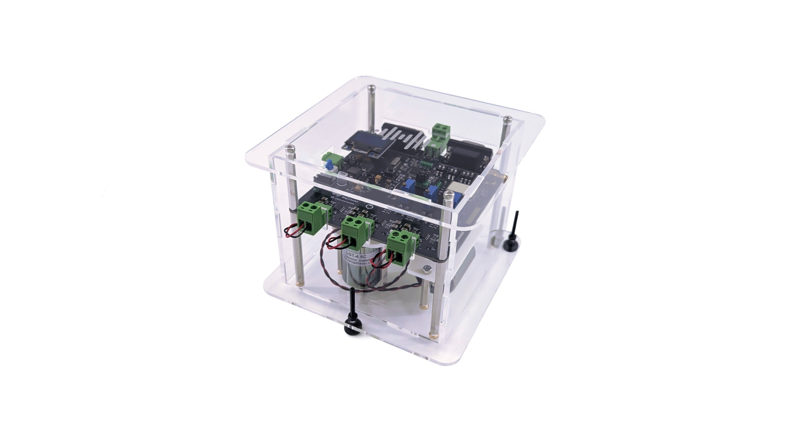

  

## 🚀 **Join the Open Science Movement!** 🚀

AnyShake Explorer is now **live on Crowd Supply**! This open-source, next-generation seismic monitoring system is officially available for crowdfunding.

👉 **[Order now on Crowd Supply](https://www.crowdsupply.com/senseplex/anyshake-explorer)** and be among the first to experience real-time seismic data visualization, analysis, and export with professional-grade performance.

📣 **Help us spread the word and grow the open science community: [www.crowdsupply.com/senseplex/anyshake-explorer](https://www.crowdsupply.com/senseplex/anyshake-explorer)**

---

## Overview

**AnyShake Explorer** is a professional-grade, fully open-source seismic monitoring platform built for **researchers**, **engineers**, **educators**, and **enthusiasts**. It combines **high-sensitivity velocity geophones** with a **32-bit precision ADC** to capture ultra-low-noise seismic data in real time.

  

Designed with versatility in mind, AnyShake Explorer transmits data via **RS-232/RS-485 serial interfaces** to its companion software, **AnyShake Observer**, for real-time visualization, storage, and analysis. It supports **simultaneous sampling of 3-axis geophones and accelerometers**, and features advanced capabilities like **GNSS/NTP time synchronization**, **OLED display**, and **digital inclinometer**.

Whether you're monitoring **earthquake activity**, conducting **structural health assessments**, or exploring **educational experiments**, AnyShake Explorer provides a **flexible**, **hackable**, and **field-ready** solution that brings high-resolution seismology within everyone’s reach.

## Features

- 🧠 **32-bit Precision ADC** – ultra-low noise data capture for professional geophones
- 🎛️ **Simultaneous 3-axis geophone + 3-axis accelerometer sampling** – full 6-channel motion capture
- 🔌 **Multiple serial interfaces** – 2× RS-232 and 1× RS-485 for flexible deployment
- ⚙️ **Flexible baud & sample rates** – supports up to 460,800 bps and 250 SPS
- 📺 **Built-in OLED display** – live status readout without a PC
- 🧭 **Digital inclinometer** – ensures precise leveling during installation
- ⏱️ **Time sync via GNSS or NTP** – millisecond-level accuracy
- 🔒 **Checksum-based data integrity** – reliable transmission over noisy links
- ⚡ **Low power operation** – only ~0.6W at 9–12V DC, perfect for remote use
- 🖥️ **Cross-platform companion software** – live streaming, waveform analysis, and export
- 🛠️ **Fully open-source** – hardware schematics, firmware, and desktop software available

## Use Cases

- **Seismology & Earthquake Research**: High-fidelity data for scientific analysis
- **Citizen Science**: Deployable anywhere, contributes to global monitoring networks
- **Structural Health Monitoring**: Track stress on bridges, buildings, etc.
- **STEM Education**: Real-time data for hands-on earthquake demos

## Technical Spec.

| Category           | Specification                                |
| ------------------ | -------------------------------------------- |
| Geophones          | 3x 4.5 Hz velocity sensors                   |
| Frequency Response | 0.5 – 27 Hz (with proper gain and filtering) |
| Accelerometer      | 3-axis, 16-bit (±2g)                         |
| ADC                | 32-bit differential                          |
| Sampling Modes     | Accel-only, Geo-only, Accel+Geo              |
| Sample Rate        | 50 / 100 / 200 / 250 SPS                     |
| Baud Rate          | 57,600 to 460,800 bps                        |
| Interfaces         | 2x RS-232, 1x RS-485                         |
| Time Sync          | GNSS & NTP support                           |
| Display            | 0.96" OLED                                   |
| Tilt Sensor        | Digital inclinometer                         |
| Power              | 9–12V DC @ ~50 mA                            |
| Software           | AnyShake Observer (open-source)              |
| Data Export        | MiniSEED, SAC, TXT, WAV                      |
| Networking         | HTTP Web, SeedLink, TCP raw stream           |

## Comparison

| Feature              | **AnyShake Explorer** | Raspberry Shake 1D | Raspberry Shake 4D | Raspberry Shake 3D |
| -------------------- | --------------------- | ------------------ | ------------------ | ------------------ |
| Open-Source Hardware | ✅                    | ❌                 | ❌                 | ❌                 |
| Open-Source Software | ✅                    | Partial            | Partial            | Partial            |
| Geophone Channels    | 3                     | 1                  | 1                  | 3                  |
| Accelerometer        | 3-axis                | ❌                 | 3-axis             | ❌                 |
| ADC Resolution       | 32-bit                | 24-bit             | 24-bit             | 24-bit             |
| Sampling Rate        | 50–250 SPS            | 100 SPS            | 100 SPS            | 100 SPS            |
| Power Usage          | ~0.6W                 | ~2.2W              | ~2.2W              | ~2.2W              |
| Customizability      | ✅                    | ❌                 | ❌                 | ❌                 |

## Get Started

**Just got your Explorer?** It ships with working firmware:

1. Connect it to your computer over RS-232 or RS-485, and power it with 9–12 V DC.
2. Install [**AnyShake Observer**](https://github.com/anyshake/observer) and follow the [**docs**](https://anyshake.org/docs/anyshake-explorer/product-overview/).
3. To update the firmware later, install the bootloader once, then update over the serial port. See the [**bootloader and dfu-tool guide**](docs/bootloader-guide.md).

| Directory                  | Contents                                                 |
| -------------------------- | -------------------------------------------------------- |
| [`docs`](docs)             | Firmware update guides, build environment, DFU internals |
| [`hardware`](hardware)     | Schematics, PCB layout, BOM (KiCad)                      |
| [`firmware`](firmware)     | MCU firmware (PlatformIO)                                |
| [`bootloader`](bootloader) | Optional UART1 bootloader for firmware updates           |
| [`dfu-tool`](dfu-tool)     | Command-line firmware update tool                        |

Prebuilt firmware, bootloader and dfu-tool are on the [**Releases**](https://github.com/anyshake/explorer/releases/latest) page.

## Credits

This project is maintained by **SensePlex Limited**, a UK-based company dedicated to developing open-source hardware and software.

## License

This project is dual-licensed:

1. **Open Source License (AGPLv3):**  
   You may use, modify, and redistribute this project under the terms of the GNU Affero General Public License version 3.0. This license requires that any derivative works also be released under the same license.

2. **Commercial License:**  
   If you intend to use this project in closed-source, commercial, or proprietary applications, please contact us at [anyshake@senseplex.net](mailto:anyshake@senseplex.net) to obtain a commercial license.

---

